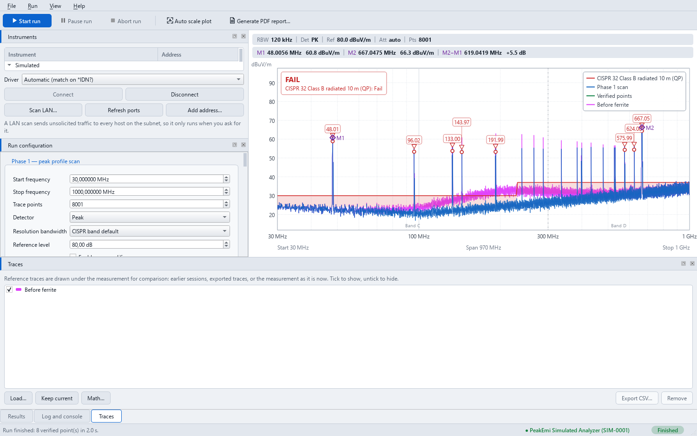
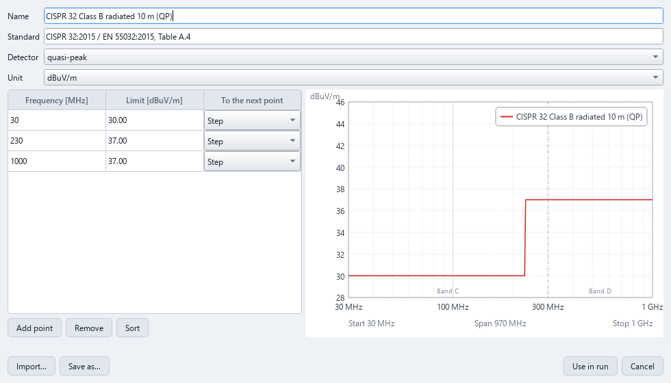

# Analysis tools

What you need on the bench between runs: comparing a measurement with an earlier one,
reading levels off the display, checking one peak again after a change, and writing a
limit line or a correction table without leaving the application.



## Reference traces

The **Traces** dock (tabbed next to the results; **View → Traces** brings it back) lists
the reference traces drawn under the measurement. Each has its own colour and legend entry,
and its tick box shows or hides it.

* **Keep current** keeps the measurement on screen as a reference. Keep one before a fix,
  apply the ferrite or the shield, run again, and both are on the display.
* **Load…** reads a PeakEmi session (its last trace) or a trace CSV, including the files
  **Export CSV…** writes. Several files can be loaded at once.
* **Math…** combines two traces into a new reference:

  | Operation            | Result at each frequency      | Typical use                        |
  |----------------------|-------------------------------|------------------------------------|
  | Worst case (maximum) | the higher of A and B         | L and N, or two antenna heights     |
  | Minimum              | the lower of A and B          | the floor common to two runs       |
  | Average              | (A + B) / 2 in dB             | smoothing two repeated scans       |
  | Difference A − B     | A − B in dB                   | how much a fix bought, per frequency |

  The result is computed on A's frequency points, with B interpolated between its own.
  Where B has no data the result has none either. Traces in different units are not
  combined.
* **Export CSV…** writes the selected reference in the same format as a measured trace.

A reference added to the display rescales it so the new trace and its legend entry fit.

### Trace CSV

One `frequency,amplitude` pair per line, frequency in hertz, ascending, comma separated.
Lines starting with `#` are metadata; `# trace:`, `# unit:`, `# detector:` and
`# corrections_applied:` are read. A header row such as `frequency_hz,amplitude_dBuV` is
skipped and also gives the unit when no `# unit:` line does. Without either, the unit is
dBµV.

```csv
# trace: Before ferrite
# unit: dBuV/m
frequency_hz,amplitude_dBuV/m
30000000,24.1
30121250,23.8
```

## Markers

Right-click the display near a peak:

* **Marker 1 / Marker 2 on this peak** puts a marker on the highest point of the
  measurement within a few pixels of the click, so it lands on the peak rather than its
  slope.
* **Clear markers** removes both.

The markers' frequency and level, and with two markers their difference in frequency and
in level, are shown in a strip under the settings bar, where they never cover the trace.
Markers stay where they are when a new sweep arrives and read the new level.

## Re-measuring peaks

To check one peak again after a change, without a new scan:

* select one or more rows in the results table and press **Re-measure selected**, or
* right-click the peak on the display and choose **Measure the peak at … MHz now**.

The selected frequencies are measured with the verification detector, dwell and bandwidth
of the current run configuration. Phase 1 is skipped. Each new point replaces the stored
point within half a verification span of it (within 10 kHz in zero span); a frequency with
no stored point is added. The verdict, margin and report follow the new values.

Re-measuring needs a connected instrument and no run in progress.

## Limit lines and correction tables

The run configuration has **New…** and **Edit…** next to **Import…** for limit lines and
correction tables; double-clicking a row also edits it.



The editor is a table of points with a live preview. A limit line point takes a frequency in
MHz, a level, and how the line continues to the next point: log-frequency (the CISPR
interpolation), linear, or a step. A correction table point takes a frequency and a value in
dB. **Sort** orders the points by frequency; the editor refuses to close while the points
cannot be used, and says why.

**Use in run** puts the result in the run configuration. **Save as…** writes it as CSV or
JSON in the format **Import…** reads (see [`resources/`](../resources)), to keep it or share
it.

Editing a built-in limit line makes an edited copy, named "(edited)", and unticks the
original: the catalogue entry itself does not change.
