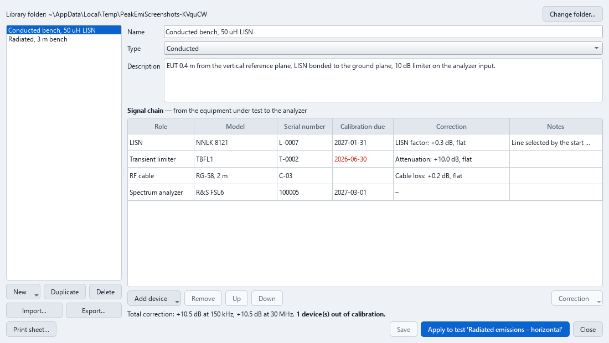
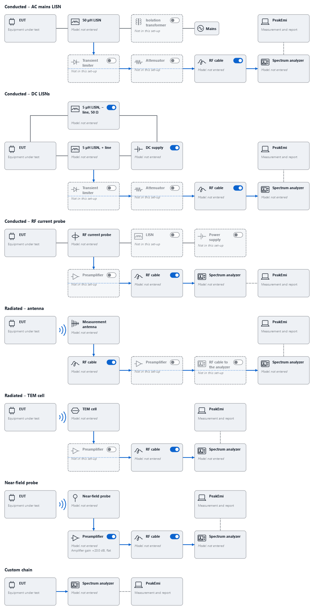
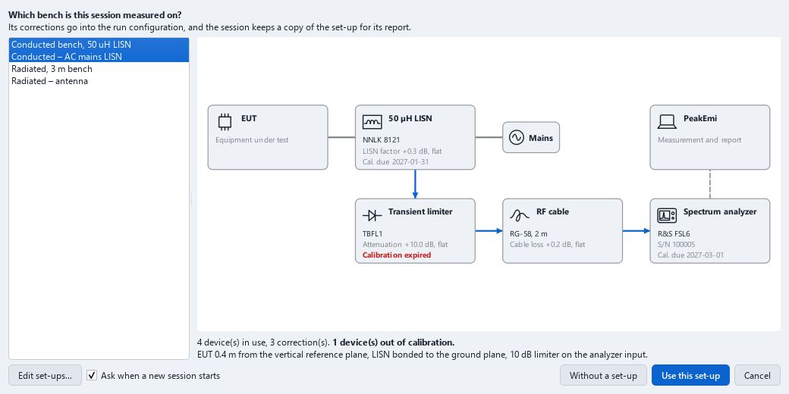

# Test set-ups

A test set-up documents a bench as it is built: the devices from the equipment under test
to the analyzer, each with its model, serial number, calibration due date, notes and, where
it changes the reading, its correction. Saved set-ups make a bench reusable from one test,
campaign or session to the next.

## The diagram

A set-up is drawn the way a lab sketches its bench: the equipment under test, what couples
its emission to the measurement chain, the supply side, and the chain itself to the analyzer
and the PC. The **method** decides the drawing and the blocks it offers:

| Method | Coupling | Other blocks |
|---|---|---|
| Conducted – AC mains LISN | 50 µH LISN | isolation transformer and mains; transient limiter, attenuator, RF cable |
| Conducted – DC LISNs | 5 µH LISN on the + line | the − line's LISN, 50 Ω terminated, beside it; DC supply; limiter, attenuator, cable |
| Conducted – RF current probe | current probe on the EUT's cable | LISN and supply; preamplifier, cable |
| Radiated – antenna | measurement antenna | cable, preamplifier, a second cable to the analyzer |
| Radiated – TEM cell | TEM cell | preamplifier, cable |
| Near-field probe | near-field probe | preamplifier, cable |
| Custom chain | – | the devices in list order |

In the library the diagram is the configurator:

- **Click a block** to pick its device in the table below, where its model, serial number,
  calibration date, notes and correction are entered. Double-click to start typing the model.
- **Flip a block's switch** to take it in or out of the set-up. Switching a block on for the
  first time adds a device for it, with the correction such a device usually has (10 dB for an
  attenuator or limiter, 20 dB of gain for a preamplifier) for you to correct. Switched off, a
  device keeps everything you entered but is left out of the equipment list, corrects
  nothing, and is drawn dashed with the signal passing it by.
- The table's tick boxes are the same switches.

A device fills the block of its role, so renaming a role moves it. A device of a role the
method has no block for joins the chain just before the analyzer.

The diagram is on the printed set-up sheet and in the session report, showing only the
blocks in use.

## Starting a session on a bench

**File ▸ New session** asks which bench the session is measured on. The chosen set-up's
corrections go into the run configuration, and the session keeps a copy of the set-up: its
report draws the bench and lists each device, its calibration judged on the day of the
measurement. **Without a set-up** starts as before; untick **Ask when a new session
starts** to stop asking. The question is skipped while the library is empty.

## Where they are kept

**Run ▸ Test set-ups…** opens the library. Each set-up is one `.peakemi-setup.json` file in
the library folder, which is PeakEmi's own data folder unless you choose another with
**Change folder…**. Point it at a shared drive and the whole lab works from one list of
benches. **Export…** and **Import…** move single set-ups between libraries; an import never
replaces a set-up that is already there.

## What a set-up holds

| Field | Purpose |
|---|---|
| Name, method, description | The method draws the diagram and sets the type (conducted, radiated or other); the description is the layout, distances and grounding someone rebuilding the bench needs |
| Devices | In signal order, EUT first and analyzer last, each switched on or off |
| Calibration due | `YYYY-MM-DD`; a lapsed date is shown in red in the library, the set-up sheet and the campaign report |
| Correction | A fixed value (attenuator, transient limiter, preamplifier gain, cable loss) or a table imported from CSV or JSON (LISN factor, antenna factor, cable loss over frequency) |

A correction belongs to its device, so listing a 10 dB limiter also corrects for it. Gains
are entered as positive numbers and subtracted from the reading. The library shows the
chain's total correction across the band, and **Print sheet…** writes a one-page PDF to
keep with the bench.

## Applying a set-up

- **To a campaign test**: select the test, then **Apply set-up…** in its Equipment tab, or
  **Apply** in the library. The test's equipment list and corrections are replaced by the
  set-up's, and the campaign report names the set-up and lists the corrections each test was
  measured with. The test keeps its own copy: changing or deleting the set-up later does not
  change a test already filed.
- **To a plain session**: with no campaign test selected, **Apply** puts the set-up's
  corrections in the run configuration, its name in the session's test set-up field, and a
  copy of it in the session, which the session report draws.

**Save as set-up…** in a test's Equipment tab turns what the test already holds into a new
set-up: each correction is attached to the device whose role matches it (an antenna factor
to the antenna, a cable loss to the cable), and a correction no device claims becomes a
device of its own.
